

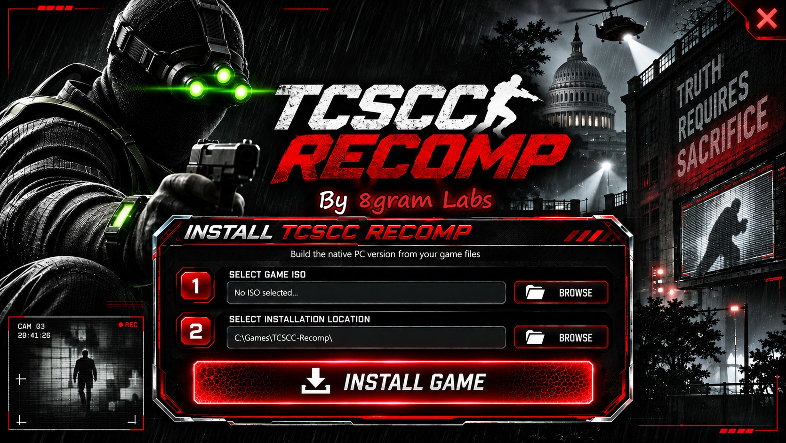

# TCSCC Recomp

**Tom Clancy's Splinter Cell: Conviction (Xbox 360) as a native Windows program. No emulator.**

> [!NOTE]
> **Complete, ready to play.** All 11 story chapters load and play with sound and saves, Deniable Ops plays,
> and co-op / Face-Off work online over Steam (System Link and Xbox LIVE Player Match). Please
> [report](https://gitlab.com/octagram-labs-group/TCSCC-Recomp/-/issues) anything that looks or plays wrong.
> **Download:** [TCSCC Recomp 0.1.0](https://gitlab.com/octagram-labs-group/TCSCC-Recomp/-/releases/permalink/latest). Later versions install from the in-game update notification.

> [!IMPORTANT]
> **No game files are included, and none ever will be.** You need your own copy of the Xbox 360 game
> (disc USA/Europe, Title ID `5553080B`).

*The title screen, running natively.*

---

## What is this?

*Splinter Cell: Conviction* came out on Xbox 360 first. This project turns the console's program
(`default.xex`) into a real Windows program:

- **The game code is translated ahead of time.** [XenonRecomp](https://github.com/hedge-dev/XenonRecomp) reads the
  console's PowerPC code and rewrites all of it (about 99,000 functions) as C++. That C++ is compiled for your PC,
  so nothing is emulated while you play.
- **The console's system calls are reimplemented** for Windows: files, threads, saves, controller, audio.
- **The Xbox 360 GPU commands and shaders are translated to Direct3D 11** as the game runs.

It is the same method as the [SCDA Recomp](https://gitlab.com/octagram-labs-group/SCDA360pcport) (*Double Agent*),
and the runtime started as a fork of it, but every engine-specific fix has been redone for this game.

## Screenshots

| | |
|:-:|:-:|
| 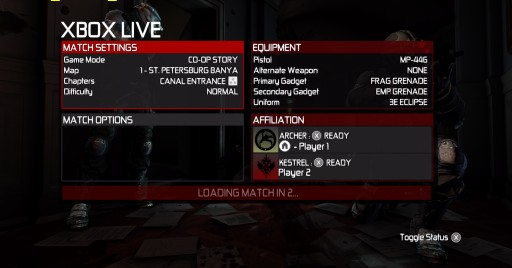 Xbox LIVE Player Match lobby, over Steam | 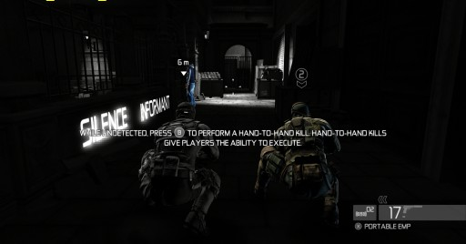 Co-op in St. Petersburg Banya, two players |
| 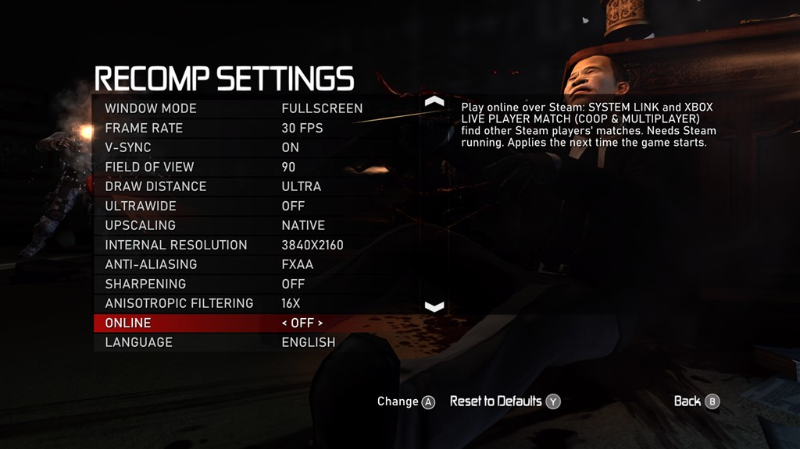 RECOMP SETTINGS, in the game's own menu | 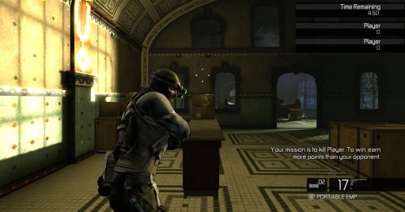 Face-Off (PvP) over System Link |
| 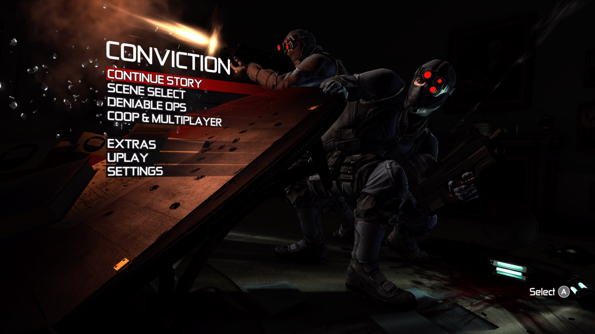 Main menu with the Steam player card (top right) | 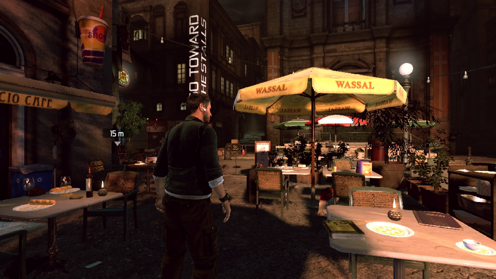 Malta market, the cafe at night |
| 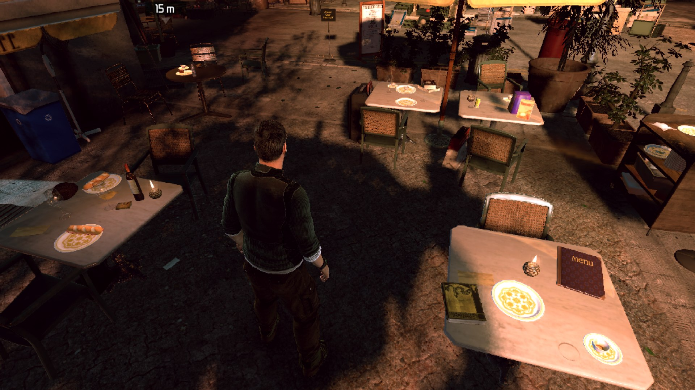 Market square | 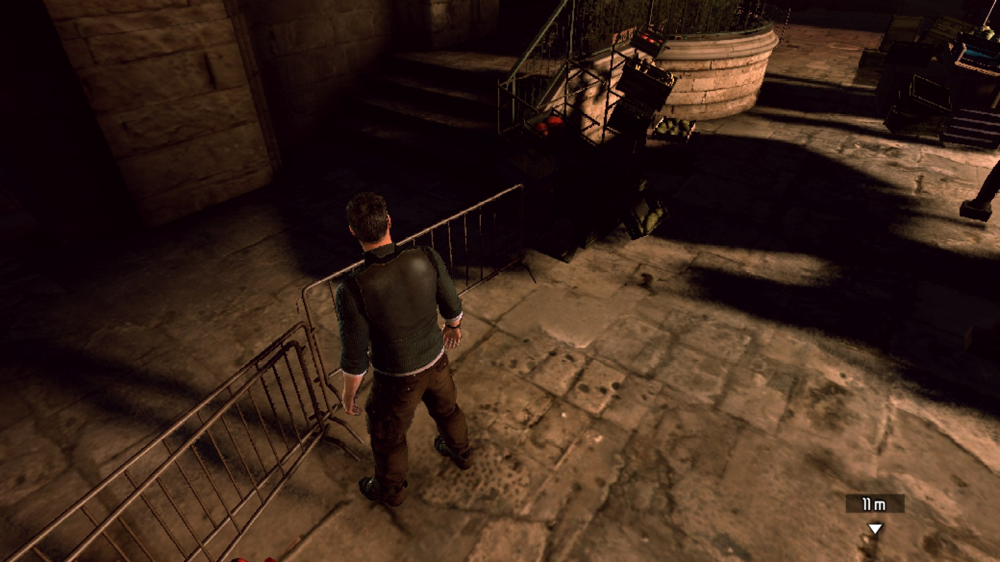 Market alley, soft shadows |
| 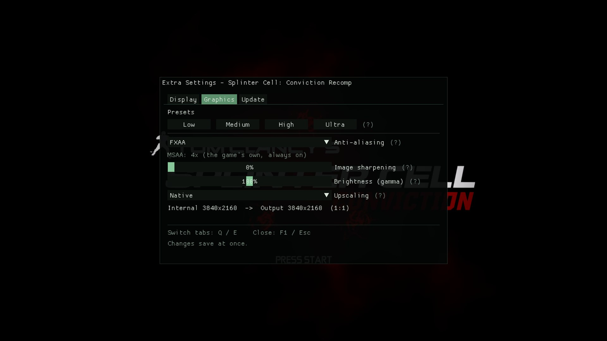 F1 menu, Graphics tab (native 4K) | |

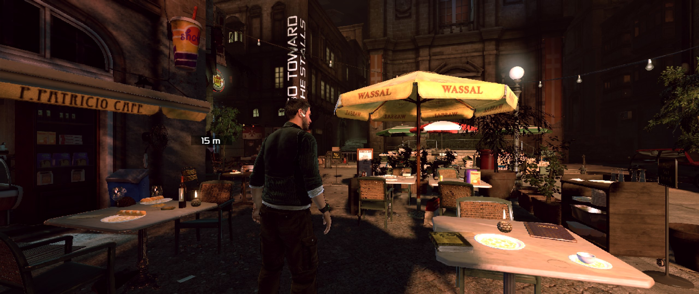

*Ultrawide (21:9): more of the scene at the sides, same vertical view. A new option, off by default.*

## What works

| Area | State |
|-|-|
| Boot, logos, title screen, menus (Scaleform UI) | Works |
| Story: all 11 chapters (`01_Market` .. `11_WhiteHouse_A`), also from Scene Select | Load and play |
| Deniable Ops (tested: Hunter, St. Petersburg Banya) | Plays |
| Audio: sound effects, dialogue, music, cutscenes (XMA) | Works |
| Saves and profiles | Work |
| Bink videos | Work |
| Languages: English, French, German, Italian, Spanish | Work (RECOMP SETTINGS > LANGUAGE) |
| Online co-op and Face-Off: System Link over Steam | Works (tested with two copies on one PC) |
| Online co-op and Face-Off: Xbox LIVE Player Match over Steam | Works (tested with two copies on one PC) |
| Controllers: Xbox, keyboard and mouse | Work; button icons follow the device |
| PlayStation 4 / 5 controllers (DualShock 4, DualSense) | Supported, icons verified; not yet tested with a real pad |
| Steam invites to a Player Match | Works on one PC (two copies); not yet tested between two Steam accounts |
| Private Match, voice chat, leaderboards | Not yet |

## Options (RECOMP SETTINGS in the main menu, or F1 / L3+R3 in game)

The main menu's UPLAY entry is replaced by **RECOMP SETTINGS**, a settings page in the game's own style.
The picture and speed options are **off by default**, so the game looks and runs like the console unless you choose
otherwise. **Online is on by default** (without Steam running the game plays offline as usual).

| Option | What it does |
|-|-|
| **Frame rate cap** | 30 (console), 60, 120, 144, 165 or 240. Game speed is unchanged (checked: the game clock, walk speed and cutscene timing match at 30, 60, 120 and 144 fps). Above 60 needs a high-refresh monitor or VSync off. Cutscenes stay at the game's own 30. |
| **Ultrawide** | In a window wider than 16:9, shows more at the sides (Hor+) instead of black bars. The HUD and menus are stretched; objective markers stay on their targets. |
| **Draw distance** | Console (default), High, Ultra or Maximum. Small objects stay visible and models keep their detailed versions 2x (High) or 4x (Ultra) further away. Maximum never hides or simplifies them. No measurable fps cost at 60 fps on 01_Market. |
| Field of view | 70-120 degrees (horizontal; the game uses 90). Zoomed views keep their own. |
| Internal resolution | Renders at 1x-4x and filters down (supersampling). The game itself renders at 1040x576. |
| **Anti-aliasing** | Off, FXAA or **SMAA** (sharper on fine detail). The game's own 4x MSAA is always on. |
| **Brightness** | Display gamma on top of the game's own brightness (50-150%); black stays black. |
| **Texture sharpness** | Default, Sharp or Sharper: more detailed textures at a distance. |
| **Upscaler** | Lanczos (default) or **NIS** (NVIDIA Image Scaling, any GPU): the filter that scales the picture up to the window when Upscaling is on. NIS sharpens while scaling; it covers up to 2x, larger steps use Lanczos. |
| Upscaling, image sharpening, anisotropic filtering | Image quality options. |
| VSync, window mode | Display options. |
| Online | On by default. Co-op and Face-Off over Steam (see [Playing online](#playing-online)). |
| **Profile name** | Your gamertag (F1 > Display). Empty: "Player" offline, your Steam name online. |
| Language | Menu, subtitle and voice language (needs that language on your disc). |

## Controls

- **Xbox controllers** work as on the console.
- **PlayStation 4 and 5 controllers** (DualShock 4, DualSense) work natively through SDL3. The
  touchpad click is Back. The button icons in menus and the HUD become PlayStation symbols.
- **Keyboard and mouse**: mouse look, every action on a key, and the button icons show your keys. Change any key in the main
  menu's **RECOMP SETTINGS > CONTROLS** (select a key, press Change, then the new key; X clears), in game in
  **F1 > Controls** (click a key, press the new one; right-click clears), or in `settings.ini` under `[Keyboard]`.

| Action | Default keys |
|-|-|
| Move / walk (hold) | W A S D / Shift |
| Camera | Mouse |
| Shoot / aim | Left / right mouse button |
| Reload | R |
| Cover / crouch | Space / C or Left Ctrl |
| Action, OK / attack, back | E or Enter / F or Backspace |
| Gadget / execute / mark | G / Q / Z or middle mouse button |
| Sonar goggles / switch weapon | T / X or mouse wheel |
| Previous / next gadget | 1 / 2 |
| Help / pause | Tab / Esc |
| Menus | Arrow keys, Enter, Backspace |

Button icons follow the device you used last; F1 > Controls > Button prompts can fix them to Xbox, PlayStation or
keyboard. The menus use the keys and the arrow keys; they have no mouse pointer (as on the console).

## Playing online

Online play goes through **Steam**: no Ubisoft or Xbox LIVE servers are needed (they are long gone). Steam carries
the game's network traffic over Valve's relays, so **no port forwarding** is needed. All players need this
project's same version and their own copy of the game.

> [!WARNING]
> So far online play has only been tested between two copies of the game on one PC. Playing between two
> PCs with different Steam accounts hasn't been tested yet. Please report how it goes.

### Set up (every player, once)

1. Start **Steam** and sign in. Keep it running while you play.
2. **ONLINE** is on by default (main menu > **RECOMP SETTINGS** > **ONLINE**; turning it off or on applies the
   next time the game starts). Without Steam running, the game plays offline as usual.
3. With Online on, you are signed in to "Xbox LIVE" with your **Steam name** as your gamertag. Steam shows you as
   playing *Spacewar*: the project uses Valve's free test app (480) to reach Steam's network.

Everything below is under **COOP & MULTIPLAYER** in the main menu.

### System Link (host and join a friend directly)

**Host:**
1. Open **SYSTEM LINK** and press **X** (Create).
2. In the lobby, choose **MATCH SETTINGS > Game Mode**: CO-OP STORY, HUNTER, LAST STAND or FACE-OFF (PvP), and
   the map.
3. Wait for *Waiting for another player to join* to change when your friend joins.

**Join:**
- Open **SYSTEM LINK**. The host's match shows in the list (press **Refresh** if it's empty, a new match can take
  a few seconds to show). Pick it with **A**.
- Or, in your Steam friends list, right-click the host and choose **Join Game**, then open **SYSTEM LINK**.

**Start:** both players press **X** (Toggle Status) to set themselves to READY. The match loads when both are ready.

### Xbox LIVE Player Match (matchmaking)

1. Open **XBOX LIVE PLAYER MATCH**, pick your settings, and press **Start** to search.
2. If someone else is searching or waiting with the same Game Mode and difficulty, you join their match.
   If nobody is, your game creates a match and waits for the next player who searches.
3. In the lobby, both players press **X** to READY. The match loads when both are ready.

Matches are found among everyone playing this project online. To play with a specific friend, agree on the same
Game Mode and difficulty and search at about the same time, or use System Link.
Private Match (Y) and Steam invites to a Player Match don't work yet.

### Troubleshooting

- *You need to be signed into Xbox LIVE*: ONLINE is off, or the game wasn't restarted after turning it on.
- Nothing is found: check that Steam is running and that both players have ONLINE on.
- Send `tcscc.log` and `steam_helper.log` (next to `tcscc.exe`) with a bug report.

## Patch notes

### 2026-11-05: PlayStation icons, keyboard and mouse controls
- **New: NIS upscaler** (NVIDIA Image Scaling) next to Lanczos, under Upscaling.
- **New: PlayStation button icons.** With a DualShock 4 or DualSense the menus and the HUD show cross, circle,
  square, triangle, L1/R1/L2/R2 and the touchpad, drawn in the game's own icon style.
- **New: keyboard icons.** Playing on keyboard and mouse, the icons show the key bound to each action.
- **New: CONTROLS** (RECOMP SETTINGS sub-menu, and F1 > Controls in game): rebind every key, mouse sensitivity,
  invert Y, and the icon style.
- **New defaults for keyboard play**, laid out for Conviction (cover on Space, shoot and aim on the mouse
  buttons, reload on R, a Walk key).
- Steam invites to a Player Match now join the host's lobby (tested with two copies on one PC).

### 2026-11-05: up to 240 fps, SMAA, native 4K, player card
- **New: frame rate cap** of 30, 60, 120, 144, 165 or 240 (was a 60 FPS switch). The engine's own limiter is
  raised; game speed, walking and cutscene timing were checked at 120 and 144.
- **New: SMAA** anti-aliasing, **Brightness** and **Texture sharpness** options.
- **New: Steam player card** on the main menu: your avatar, name and online status.
- **New: Profile name** setting (your gamertag, offline and online).
- **Changed: Online is on by default.** Without Steam running, the game plays offline as before; saves are the
  same either way.
- **Fixed: blurry picture on scaled displays.** On a 4K screen at 150% scaling, the game rendered at 2560x1440 and
  Windows stretched it. It now renders at the screen's real resolution.
- **Fixed:** the RECOMP SETTINGS list ran past its panel.
- **Faster, cooler:** three busy-wait loops (the GPU query wait, the file streamer and the frame limiter) now sleep. The
  game uses about 40% less CPU at the same frame rate (main menu 4.1 -> 2.4 cores, gameplay 3.3 -> 1.9); on a
  4-core CPU the menu went from 57 to 59 fps.
- Tested: all 11 chapters, 400 s each with the new options on, no crash.

### 2026-11-05: online play
- **New: online co-op and Face-Off over Steam.** System Link finds other players' matches through Steam, and
  Steam's Join Game works. Xbox LIVE Player Match matchmaking works without Ubisoft's servers. Your Steam name
  is your gamertag.
- **New: RECOMP SETTINGS** in the main menu (it replaces UPLAY, which quit the game). All the PC options, in the
  game's own menu style.
- **Fixed: Language setting** (French, German, Italian and Spanish now load).
- **Fixed: stutters** when entering new areas. Shaders now compile in the background.
- **Fixed:** shaders with loops the compiler couldn't unroll were missing.
- **Fixed:** the F1 menu's rows ran under its footer. Changing Window mode applies at once.
- New app icon.

### 2026-11-04: all chapters, draw distance, field of view
- **Fixed: Scene Select** reaches all 11 chapters (all tested, no crash).
- **Fixed: crash in 07_LincolnMemorial** (a rendering race).
- **Fixed: robotic voices** in streamed dialogue (e.g. the first mission's cafe call) and glitches in the music.
- **Fixed: no music.** The menu music, the music during missions and the sound of mission intro cutscenes stopped after a few seconds (streamed audio got stuck).
- **Fixed: the Field of view slider did nothing.** It now widens or narrows the player camera (default 90).
- **New: Draw distance option.** On the console, about half the small-object tests in the market hide the object.
  High cuts that to about a tenth, and Ultra to about 1%. Models also switch to their simpler versions later.

### 2026-11-04: 60 fps, ultrawide, picture fixes
- **New: 60 FPS option.** Gameplay runs at 57-60 fps. The renderer now wakes up as soon as a frame is ready
  instead of polling every millisecond (+4-9% fps on its own).
- **New: Ultrawide option (Hor+).** The camera widens to the window's aspect; tested at 21:9 and 32:9.
- **Fixed: black strip on the right edge of every frame.** The game draws a 1040-pixel-wide image into a
  1056-pixel buffer; only the real image is shown now.
- **Fixed: stretched picture in non-16:9 windows.** Without Ultrawide, the image keeps 16:9 with black bars.
- **Fixed: lamp light wedges** in the market (particle quads read the wrong vertex records).
- **Fixed: "Corrupted Data - Player"** on a new profile.
- **Fixed: crash when a mission loads** (the save icon used a freed loading-screen movie).
- **Fixed: no sound in missions** (the game's XMA audio path is now handled).
- Window and menu titles say Conviction.

### 2026-11-03: the world renders
- **Fixed: empty menu and mission worlds.** Conviction decides what is visible on the GPU (a pixel shader that
  writes to memory, plus a depth pyramid). Both are now implemented, so the world draws.
- **Fixed: flat-colour world** (texel-space texture coordinates were ignored).
- **Fixed: blown-out lighting.** HDR exponent bias on render targets, resolves and textures was ignored; the
  market cafe is now at night with warm lamp light, like on the console.
- **Fixed: black light volumes** (signed light-falloff textures read as unsigned).
- **Speed:** texture change detection no longer rehashes unrelated memory (gameplay went from a crawl to 30 fps).
- First boot, first menu, first mission.

## Building from source

You need your own game disc image. Nothing from the game is in this repository.

1. Tools: Visual Studio 2022 Build Tools, LLVM (clang-cl), CMake + Ninja, Python 3, Git Bash.
2. Clone [XenonRecomp](https://github.com/hedge-dev/XenonRecomp) (commit `ddd128b`) into `external/XenonRecomp`,
   apply `tools/patches/xenonrecomp_pz.patch`, then build it: `tools/build_xenonrecomp.bat`.
3. Extract `default.xex` from your disc into `assets/` and make the flat image with `tools/xex_dump`
   (its SHA-256 must match `config/expected_image.txt`).
4. Recompile the game code: `sh tools/recomp.sh` (writes `generated/`, which is git-ignored).
5. Optional, for online play: put the [Steamworks SDK](https://partner.steamgames.com/downloads/list) 1.65 in
   `external/steamworks_sdk_165` (its `sdk` folder inside). Without it the build has no Steam support.
6. Build the runtime: `tools/build_runtime.bat` -> `runtime/build/tcscc.exe` (and `steam_api64.dll` next to it).
7. Run it from a folder holding the game's files. Its log is `tcscc.log`.

Tests: `python -I -m unittest discover -s tools/tests -t .` and `tools/test_runtime.bat`.

## Reporting bugs

[Open an issue](https://gitlab.com/octagram-labs-group/TCSCC-Recomp/-/issues) with a screenshot or video, the mission and
place, and your `tcscc.log`.

## Credits and license

By **8gram Labs**. The source code is GPL-3.0 (see `LICENSE`). Built on XenonRecomp, XenosRecomp,
UnleashedRecomp, Xenia (reference), FFmpeg, Dear ImGui and more: see [`THIRD_PARTY_NOTICES.md`](THIRD_PARTY_NOTICES.md).

## Legal

This is an unofficial fan project. It isn't made, approved or supported by Ubisoft or Microsoft. *Tom Clancy's*,
*Splinter Cell*, *Splinter Cell: Conviction*, Sam Fisher and everything related belong to Ubisoft Entertainment.
Xbox and Xbox 360 are trademarks of Microsoft.

- **No game files are included.** This repository only has original source code, build scripts and settings (like
  where functions are in the game's program). It contains no game program, recompiled game code, graphics, sound,
  video or text. The recompiled code (`generated/`) is made on your own PC and is never published.
- **You need to own the game.** Building only works with your own Xbox 360 disc image of *Splinter Cell:
  Conviction*. The tools check the image and build everything on your own PC. Please don't ask for or share game
  files or disc images here. Those issues will be closed.
- **No piracy.** This project doesn't help anyone get the game. To read the game's code, the tools unpack the program
  from your own disc on your own PC, the same way other Xbox 360 recompilation projects do.
- **Screenshots** in `docs/images/` were taken with this project running the author's own copy of the game. They're
  only here to show progress. The banner is the author's own artwork.
