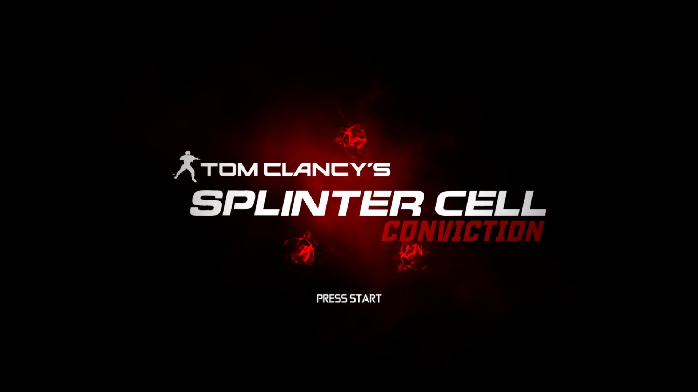

# TCSCC Recomp

**Tom Clancy's Splinter Cell: Conviction (Xbox 360) as a native Windows program. No emulator.**

> [!NOTE]
> **Work in progress.** The game boots to the title screen, menus work, and the first missions load and play
> with sound and saves. There is no installer release yet.

> [!IMPORTANT]
> **No game files are included, and none ever will be.** You need your own copy of the Xbox 360 game
> (disc USA/Europe, Title ID `5553080B`).

*The title screen, running natively.*

---

## What is this?

*Splinter Cell: Conviction* came out on Xbox 360 first. This project turns the console's program
(`default.xex`) into a real Windows program:

- **The game code is translated ahead of time.** [XenonRecomp](https://github.com/hedge-dev/XenonRecomp) reads the
  console's PowerPC code and rewrites all of it (about 99,000 functions) as C++. That C++ is compiled for your PC,
  so nothing is emulated while you play.
- **The console's system calls are reimplemented** for Windows: files, threads, saves, controller, audio.
- **The Xbox 360 GPU commands and shaders are translated to Direct3D 11** as the game runs.

It is the same method as the [SCDA Recomp](https://gitlab.com/octagram-labs-group/SCDA360pcport) (*Double Agent*),
and the runtime started as a fork of it, but every engine-specific fix has been redone for this game.

## Screenshots

| | |
|:-:|:-:|
|  Main menu |  Malta market, the cafe at night |
|  Market square |  Market alley, soft shadows |

*Ultrawide (21:9): more of the scene at the sides, same vertical view. A new option, off by default.*

## What works

| Area | State |
|-|-|
| Boot, logos, title screen, menus (Scaleform UI) | Works |
| First chapters: `01_Market` (Malta), `02_Museum`, `03_Airfield`, `04_FB-Coste` | Load and play |
| Deniable Ops (tested: Hunter, St. Petersburg Banya) | Plays |
| In-mission audio (XMA) | Works |
| Saves and profiles | Work (a new profile no longer shows *Corrupted Data*) |
| Bink videos | Work |
| Later chapters picked in Scene Select | Not yet: they start the first chapter |

## Options (F1 / L3+R3 in game)

Everything new is **off by default**, so the game looks and runs like the console unless you choose otherwise.

| Option | What it does |
|-|-|
| **60 FPS** | Lifts the game's 30 fps cap. Game speed is unchanged (checked: the game clock, walk speed and camera turn speed match at 30 and 60 fps). |
| **Ultrawide** | In a window wider than 16:9, shows more at the sides (Hor+) instead of black bars. The HUD and menus are stretched; objective markers stay on their targets. |
| **Draw distance** | Console (default), High, Ultra or Maximum. Small objects stay visible and models keep their detailed versions 2x (High) or 4x (Ultra) further away. Maximum never hides or simplifies them. No measurable fps cost at 60 fps on 01_Market. |
| Internal resolution | Renders at 1x-4x and filters down (supersampling). The game itself renders at 1040x576. |
| Upscaling, FXAA, sharpening, anisotropic filtering | Image quality options. |
| VSync, window mode | Display options. |

## Patch notes

### 2026-11-04: draw distance
- **New: Draw distance option.** On the console, about half the small-object tests in the market hide the object.
  High cuts that to about a tenth, and Ultra to about 1%. Models also switch to their simpler versions later.

### 2026-11-04: 60 fps, ultrawide, picture fixes
- **New: 60 FPS option.** Gameplay runs at 57-60 fps. The renderer now wakes up as soon as a frame is ready
  instead of polling every millisecond (+4-9% fps on its own).
- **New: Ultrawide option (Hor+).** The camera widens to the window's aspect; tested at 21:9 and 32:9.
- **Fixed: black strip on the right edge of every frame.** The game draws a 1040-pixel-wide image into a
  1056-pixel buffer; only the real image is shown now.
- **Fixed: stretched picture in non-16:9 windows.** Without Ultrawide, the image keeps 16:9 with black bars.
- **Fixed: lamp light wedges** in the market (particle quads read the wrong vertex records).
- **Fixed: "Corrupted Data - Player"** on a new profile.
- **Fixed: crash when a mission loads** (the save icon used a freed loading-screen movie).
- **Fixed: no sound in missions** (the game's XMA audio path is now handled).
- Window and menu titles say Conviction.

### 2026-11-03: the world renders
- **Fixed: empty menu and mission worlds.** Conviction decides what is visible on the GPU (a pixel shader that
  writes to memory, plus a depth pyramid). Both are now implemented, so the world draws.
- **Fixed: flat-colour world** (texel-space texture coordinates were ignored).
- **Fixed: blown-out lighting.** HDR exponent bias on render targets, resolves and textures was ignored; the
  market cafe is now at night with warm lamp light, like on the console.
- **Fixed: black light volumes** (signed light-falloff textures read as unsigned).
- **Speed:** texture change detection no longer rehashes unrelated memory (gameplay went from a crawl to 30 fps).
- First boot, first menu, first mission.

## Building from source

You need your own game disc image. Nothing from the game is in this repository.

1. Tools: Visual Studio 2022 Build Tools, LLVM (clang-cl), CMake + Ninja, Python 3, Git Bash.
2. Clone [XenonRecomp](https://github.com/hedge-dev/XenonRecomp) (commit `ddd128b`) into `external/XenonRecomp`,
   apply `tools/patches/xenonrecomp_pz.patch`, then build it: `tools/build_xenonrecomp.bat`.
3. Extract `default.xex` from your disc into `assets/` and make the flat image with `tools/xex_dump`
   (its SHA-256 must match `config/expected_image.txt`).
4. Recompile the game code: `sh tools/recomp.sh` (writes `generated/`, which is git-ignored).
5. Build the runtime: `tools/build_runtime.bat` -> `runtime/build/tcscc.exe`.
6. Run it from a folder holding the game's files. Its log is `scda.log`.

Tests: `python -I -m unittest discover -s tools/tests -t .` and `tools/test_runtime.bat`.

## Reporting bugs

[Open an issue](https://gitlab.com/octagram-labs-group/TCSCC-Recomp/-/issues) with a screenshot or video, the mission and
place, and your `scda.log`.

## Credits and license

By **8gram Labs**. The source code is GPL-3.0 (see `LICENSE`). Built on XenonRecomp, XenosRecomp,
UnleashedRecomp, Xenia (reference), FFmpeg, Dear ImGui and more: see [`THIRD_PARTY_NOTICES.md`](THIRD_PARTY_NOTICES.md).

## Legal

This is an unofficial fan project. It isn't made, approved or supported by Ubisoft or Microsoft. *Tom Clancy's*,
*Splinter Cell*, *Splinter Cell: Conviction*, Sam Fisher and everything related belong to Ubisoft Entertainment.
Xbox and Xbox 360 are trademarks of Microsoft.

- **No game files are included.** This repository only has original source code, build scripts and settings (like
  where functions are in the game's program). It contains no game program, recompiled game code, graphics, sound,
  video or text. The recompiled code (`generated/`) is made on your own PC and is never published.
- **You need to own the game.** Building only works with your own Xbox 360 disc image of *Splinter Cell:
  Conviction*. The tools check the image and build everything on your own PC. Please don't ask for or share game
  files or disc images here. Those issues will be closed.
- **No piracy.** This project doesn't help anyone get the game. To read the game's code, the tools unpack the program
  from your own disc on your own PC, the same way other Xbox 360 recompilation projects do.
- **Screenshots** in `docs/images/` were taken with this project running the author's own copy of the game. They're
  only here to show progress. The banner is the author's own artwork.
